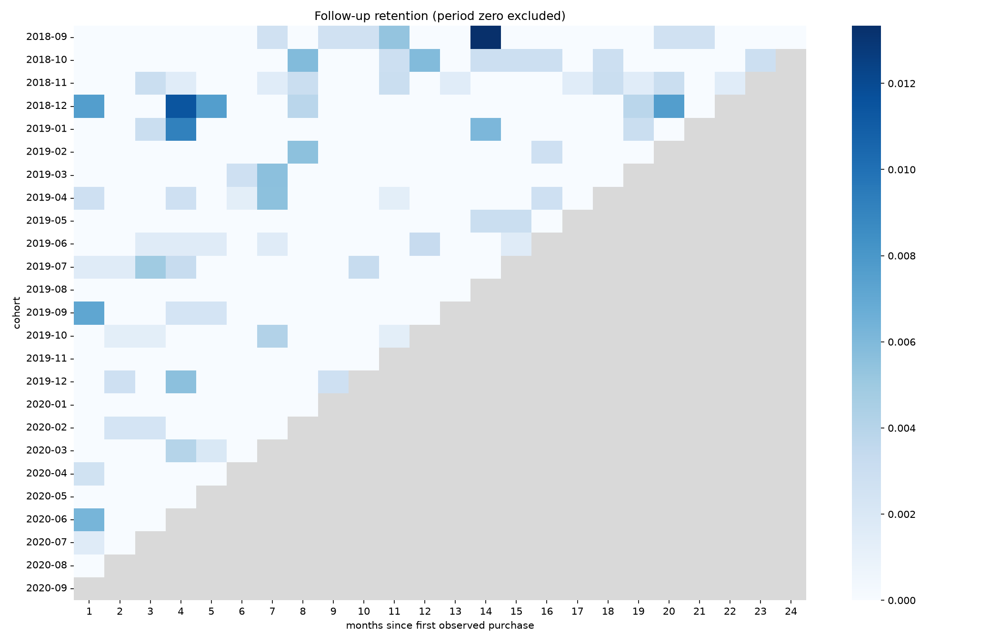
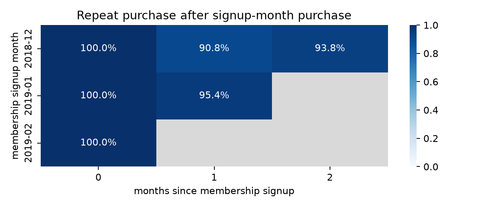

# 이커머스 멀티 모달 데이터 분석 및 RFM 비즈니스 인사이트 파이프라인 구축

상품 이미지/텍스트/가격과 실제 거래를 연결하고 EDA, RFM, 코호트, 인터랙티브 시각화를 수행합니다.

## 실행 환경

미션 전용 격리 환경에서 수행합니다. 실제 버전과 데이터 출처는 준비 후 기록합니다.

## 진행 상태

데이터 확보와 환경 준비 중입니다. 실제 실행 결과를 항목별로 추가합니다.

## 거래와 상품 데이터

H&M Personalized Fashion Recommendations 공개 미러의 커밋 `acde210b0090be673abdba5f989c48925c856f78`에서 상품 메타데이터와 실제 거래를 확보했습니다. 3.49GB 거래 전체 중 일정한 바이트 간격의 1MiB 구간 32개를 읽고 경계의 불완전한 레코드를 제거했습니다. 표본은 시간 구간을 분산한 것이며 고객 전체 거래 이력이라고 해석하지 않습니다.

```text
range 0 rows 9554
range 1 rows 9556
range 2 rows 9555
range 3 rows 9558
range 4 rows 9549
range 5 rows 9550
range 6 rows 9556
range 7 rows 9548
range 8 rows 9547
range 9 rows 9558
range 10 rows 9555
range 11 rows 9549
range 12 rows 9553
range 13 rows 9551
range 14 rows 9555
range 15 rows 9557
range 16 rows 9558
range 17 rows 9555
range 18 rows 9562
range 19 rows 9559
range 20 rows 9563
range 21 rows 9562
range 22 rows 9565
range 23 rows 9563
range 24 rows 9550
range 25 rows 9557
range 26 rows 9554
range 27 rows 9555
range 28 rows 9549
range 29 rows 9552
range 30 rows 9552
range 31 rows 9554
DONE 305761 transactions 36127865 article bytes
```

출처: [원 데이터 안내](https://data.hmgroup.com/), [공개 미러](https://huggingface.co/datasets/einrafh/hnm-fashion-recommendations-data). 이미지와의 연결 및 결측/분포 분석은 이어서 수행합니다. 원본 표본과 Range별 SHA-256은 실습 데이터에 보존합니다.

## 파이프라인 검증

이미지 평균/표준편차의 벡터 연산, 히스토그램 합, 그룹 대치/전체 통계 보완, IQR 원본 보존, 구매일 기준 Frequency, 코호트 우측 절단을 확인했습니다.

```text
$ python -m unittest discover -s tests -v
test_all_missing_rejected (test_pipeline.PipelineTests.test_all_missing_rejected)
모든 값이 결측이면 임의 숫자를 만들지 않는다. ... ok
test_bad_image_shapes (test_pipeline.PipelineTests.test_bad_image_shapes)
잘못된 차원과 비유한 값을 거절한다. ... ok
test_cohort_keeps_observed_empty_months (test_pipeline.PipelineTests.test_cohort_keeps_observed_empty_months)
재구매가 전혀 없는 관측 가능한 달도 0으로 남긴다. ... ok
test_cohort_right_censoring (test_pipeline.PipelineTests.test_cohort_right_censoring)
관측되지 않은 미래 월을 재구매 0으로 채우지 않는다. ... ok
test_group_imputation_and_fallback (test_pipeline.PipelineTests.test_group_imputation_and_fallback)
그룹 통계와 전체 통계 보완의 실제 값을 확인한다. ... ok
test_iqr (test_pipeline.PipelineTests.test_iqr)
IQR 이상치와 원본 불변을 확인한다. ... ok
test_rfm_purchase_days (test_pipeline.PipelineTests.test_rfm_purchase_days)
Frequency를 같은 날 구매한 상품 수와 혼동하지 않는다. ... ok
test_vector_features (test_pipeline.PipelineTests.test_vector_features)
이미지별 독립 계산과 배치 벡터 연산을 비교한다. ... ok

----------------------------------------------------------------------
Ran 8 tests in 0.204s

OK
```

## EDA와 이미지 피처

원본 상품 ID에 일치하는 사진 126개를 확보했습니다. 이미지 CDN은 404여서 거래와 같은 고정 revision의 사진 미러를 사용했습니다. 사진이 없는 상품 2개의 해당 거래 행은 category 평균으로 피처를 대치하고, 상관계수는 관측 이미지가 있는 행만 사용했습니다. 실제 가격과 거래는 바꾸지 않았습니다.

```text
$ python -m src.analysis eda --data data/analysis_transactions.csv --images data/images
{
  "rows": 16739,
  "columns": 16,
  "products": 128,
  "customers": 11372,
  "first_date": "2018-09-20",
  "last_date": "2020-09-22",
  "images_observed": 126,
  "image_missing_rows": 480,
  "iqr_bounds": [
    -0.010330508474576275,
    0.05333050847457627
  ],
  "outlier_count": 0,
  "brightness_outlier_count": 206,
  "brightness_iqr_bounds": [
    0.44839218239379103,
    1.0011852787990196
  ],
  "statistics": {
    "price": {
      "count": 16739.0,
      "mean": 0.021255601199269746,
      "std": 0.010402439764952226,
      "min": 0.0013389830508474577,
      "25%": 0.013542372881355931,
      "50%": 0.01871186440677966,
      "75%": 0.029457627118644067,
      "max": 0.050830508474576264
    },
    "name_length": {
      "count": 16739.0,
      "mean": 17.4870063922576,
      "std": 6.131977050131017,
      "min": 5.0,
      "25%": 13.0,
      "50%": 16.0,
      "75%": 24.0,
      "max": 30.0
    },
    "word_count": {
      "count": 16739.0,
      "mean": 3.267100782603501,
      "std": 1.2141573464562256,
      "min": 1.0,
      "25%": 2.0,
      "50%": 3.0,
      "75%": 4.0,
      "max": 6.0
    },
    "image_mean": {
      "count": 16739.0,
      "mean": 0.7232713385928418,
      "std": 0.10417977541425866,
      "min": 0.289093137254902,
      "25%": 0.6556895935457517,
      "50%": 0.7186517054738563,
      "75%": 0.7938878676470589,
      "max": 0.915872651143791
    },
    "image_std": {
      "count": 16739.0,
      "mean": 0.27545144981320374,
      "std": 0.11401107352420921,
      "min": 0.015205474442991767,
      "25%": 0.2203384075086901,
      "50%": 0.317546220117022,
      "75%": 0.3607536410175765,
      "max": 0.4063810403499021
    },
    "image_edge": {
      "count": 16739.0,
      "mean": 0.04812637615436799,
      "std": 0.020169815079584423,
      "min": 0.005499551971326165,
      "25%": 0.04053341766814252,
      "50%": 0.04905057453088762,
      "75%": 0.05798215791693021,
      "max": 0.12763085072738772
    }
  },
  "correlations": {
    "price_word_count": 0.24276810240735539,
    "price_image_mean": -0.004372270195836988
  },
  "monthly_sample_monetary": {
    "2018-09-01": 10.69364406779661,
    "2018-10-01": 8.98406779661017,
    "2018-11-01": 18.39415254237288,
    "2018-12-01": 8.322423728813558,
    "2019-01-01": 11.128474576271184,
    "2019-02-01": 12.711322033898304,
    "2019-03-01": 12.067254237288134,
    "2019-04-01": 24.34850847457627,
    "2019-05-01": 10.453999999999999,
    "2019-06-01": 17.833322033898305,
    "2019-07-01": 16.12406779661017,
    "2019-08-01": 11.814406779661017,
    "2019-09-01": 15.01908474576271,
    "2019-10-01": 24.753406779661013,
    "2019-11-01": 15.846152542372883,
    "2019-12-01": 9.700203389830508,
    "2020-01-01": 17.307271186440673,
    "2020-02-01": 13.16050847457627,
    "2020-03-01": 16.21377966101695,
    "2020-04-01": 12.859762711864406,
    "2020-05-01": 12.506016949152542,
    "2020-06-01": 12.463576271186438,
    "2020-07-01": 16.993135593220337,
    "2020-08-01": 13.805338983050847,
    "2020-09-01": 12.293627118644068
  },
  "missing_before": {
    "order_date": 0,
    "customer_id": 0,
    "article_id": 0,
    "price": 0,
    "sales_channel_id": 0,
    "product_name": 0,
    "category": 0,
    "colour": 0,
    "department": 0,
    "detail_desc": 0,
    "name_length": 0,
    "word_count": 0,
    "image_mean": 480,
    "image_std": 480,
    "image_edge": 480,
    "image_available": 0
  },
  "imputation": {
    "before": {
      "image_mean": 480,
      "image_std": 480,
      "image_edge": 480
    },
    "after": {
      "image_mean": 0,
      "image_std": 0,
      "image_edge": 0
    }
  }
}
```


분석 표본은 16,739행/128상품/11,372고객입니다. 가격은 원 데이터의 정규화 단위이며 원화/달러 매출로 해석하지 않습니다. IQR 밖 0행은 분포 비교용으로만 분리했고 실제 구매를 오류로 단정해 RFM에서 삭제하지 않았습니다.

가격과 단어 수 상관계수는 0.2428, 관측 이미지 밝기와는 -0.0044입니다. 이 상관관계만으로 상품 설명이나 촬영 밝기가 가격을 결정한다고 해석할 수 없으며, 카테고리/상품 선택의 영향을 함께 고려해야 합니다.

가격의 기본 IQR 경계에서는 이상치가 0건이었습니다. 별도로 이미지 밝기에서 실제 206행을 탐지하고 전후 분포를 비교했습니다. 이상치 판정만으로 데이터 오류라고 단정하지 않습니다.


## RFM 고객 세분화

기준일은 최종 관측일 다음 날입니다. 주문 ID가 없어 Frequency는 서로 다른 관측 구매일 수로 정의하고 Monetary는 실제 상품 행 금액 합계로 계산했습니다. 동일 날 여러 상품을 구매한 행을 여러 주문으로 세지 않았습니다.

```text
$ python -m src.analysis rfm --interactive
{
  "reference_date": "2020-09-23",
  "customer_count": 11372,
  "frequency_definition": "distinct observed purchase dates, not line-item count",
  "segments": {
    "Churned": {
      "customers": 5626,
      "mean_recency": 549.1551724137931,
      "mean_frequency": 1.0,
      "mean_monetary": 0.030856845035458855,
      "total_monetary": 173.60061016949152
    },
    "Loyal": {
      "customers": 41,
      "mean_recency": 427.8048780487805,
      "mean_frequency": 2.0,
      "mean_monetary": 0.05857999173212071,
      "total_monetary": 2.401779661016949
    },
    "New": {
      "customers": 5629,
      "mean_recency": 179.9236098774205,
      "mean_frequency": 1.0,
      "mean_monetary": 0.031083986980256596,
      "total_monetary": 174.9717627118644
    },
    "VIP": {
      "customers": 76,
      "mean_recency": 186.03947368421052,
      "mean_frequency": 2.013157894736842,
      "mean_monetary": 0.06346520963425513,
      "total_monetary": 4.823355932203389
    }
  }
}
```


[인터랙티브 RFM 차트](outputs/rfm-interactive.html)는 Plotly 보너스 구현입니다.

## 코호트 재구매 분석

계정 생성일이 제공되지 않아 코호트 가입월은 표본에서 최초로 관측한 구매월로 정의했습니다. 실제 계정 가입월/생애 최초 구매월과는 구분합니다. 아직 관측할 수 없는 미래 기간은 0이 아닌 결측으로 남겼습니다.

```text
$ python -m src.analysis cohort
{
  "cohorts": 25,
  "periods": 25,
  "first_purchase_definition": "first observed purchase in sampled time ranges; account signup dates unavailable",
  "right_censored_cells": 300,
  "period_zero_min": 1.0,
  "period_zero_max": 1.0
}
```


## 데이터 준비 재현

고정 revision, Range 응답 검증과 SHA-256을 포함한 `src.dataset`으로 같은 표본을 준비할 수 있습니다. 캐시를 이용한 전체 재현에서 선택 CSV가 원본 표본과 바이트 단위로 일치했습니다. 사진 2개의 404는 성공으로 처리하지 않고 결측 상태로 남깁니다. 원본 데이터와 사진은 저장소에 재배포하지 않습니다.

```text
$ python -m src.dataset --output data
{
  "revision": "acde210b0090be673abdba5f989c48925c856f78",
  "raw_rows": 305761,
  "selected_rows": 16739,
  "products": 128,
  "images_downloaded": 126,
  "images_failed": 2,
  "articles_sha256": "25f21882053517f7684ea43f524225a9481a7bb9aab9cf0abfc7fe8c4576a72b",
  "selected_csv_sha256": "183c0bc8dbb1df689f3cb145dc85fd4410d26e617da918753b823a654161c1ea"
}
```

재구매가 없는 관측 가능한 달도 표에서 빠지지 않도록 전체 월을 명시적으로 재색인했습니다. 관측 가능한 0과 미래 미관측을 구분하는 회귀 검사를 추가했습니다.

## 비즈니스 인사이트

1. 관측 휴면 고객의 재방문 실험

근거: Churned는 5,626명(49.47%)이고 평균 Recency는 549.2일입니다.
실행: 이 관측 세그먼트에 재방문 혜택을 노출하는 실험군/대조군을 구성하고 재구매일 수의 증가를 기대합니다.
검증: 표본 밖 거래가 누락되어 있으므로 실제 전체 거래 이력과 최근 방문 기록이 필요합니다. 이탈했다고 단정한 캠페인은 오분류일 수 있습니다.

2. 관측 고빈도/고금액 고객의 유지 전략

근거: VIP는 76명이고 표본 금액의 1.36%를 차지합니다. 평균 구매일 수는 2.01입니다.
실행: VIP에게 관심 카테고리 신상품을 우선 안내하는 실험으로 구매일 수 유지와 교차 구매를 기대합니다.
검증: 상품 마진/할인 비용/전체 고객 생애 구매를 추가로 확인해야 하며, 이 관측 표본만으로 LTV나 캠페인 수익을 계산할 수 없습니다.

3. 최근 관측 저빈도 고객의 다음 구매 유도

근거: New는 5,629명(49.50%)이고 관측 구매일 수는 평균 1.00입니다.
실행: 이 고객에게 첫 관측 상품과 관련된 카테고리를 추천하고 다음 관측 구매일 발생률의 증가를 확인합니다.
검증: New는 실제 신규 가입자가 아닌 RFM 규칙 이름입니다. 실제 가입일과 전체 거래를 확인하면 기존 고객으로 판명될 수 있습니다.


## 실행 방법

```bash
python3 -m venv .venv
source .venv/bin/activate
pip install -r requirements.txt
python -m src.dataset --output data
python -m src.analysis eda
python -m src.analysis rfm --interactive
python -m src.analysis cohort
python -m unittest discover -s tests -v
```

[분석 노트북](notebooks/analysis_report.ipynb)에는 info/describe/head, 통계 해석, 실제 그래프, RFM 전략과 코호트 결과가 포함됩니다. 이미지 통계는 일괄 NumPy 연산이며 파일 입력 외에는 이미지 처리 라이브러리를 사용하지 않습니다. Histogram/차분 Edge 피처와 구매 코호트, Plotly 차트가 보너스 3종입니다.

월별 금액과 재구매율은 시간 분산 표본/인기 상품에 한정됩니다. 실제 전체 거래/가입일/마진을 확인하기 전에는 회사 매출, 실제 고객 이탈률이나 캠페인 수익으로 일반화하지 않습니다.

관측 이미지가 없는 행은 480/16,739건(2.87%)입니다. 대치 피처와 실제 관측 피처를 구분하며, 상관계수는 거래 행으로 가중된 값이므로 독립적인 상품 16,739개를 분석한 결과가 아닙니다.

최빈 카테고리 Trousers은 5,066행(30.26%)입니다. 인기 상품 표본의 구성 효과가 크므로 전체 상품군 수요와 구분해 해석해야 합니다. 월별 표본 금액도 추출된 거래 구간과 상품 선택 영향을 받으며 실제 회사 성장률로 해석하지 않습니다.

코호트 그림의 회색은 미래 미관측, 밝은 색은 관측된 낮은 재구매율입니다. 기간 0의 100%가 작은 재구매율을 가리지 않도록 기간 0을 제외한 확대 그림도 함께 제공합니다. 이상치 전후 히스토그램은 같은 bin 경계를 사용했습니다.



## 브라우저 확인

오프라인 HTML을 기존 Chrome headless 세션에서 열어 세그먼트별 점 수와 범례 클릭을 확인했습니다.

```json
{
  "traces": [
    {
      "name": "Churned",
      "points": 5626
    },
    {
      "name": "New",
      "points": 5629
    },
    {
      "name": "VIP",
      "points": 76
    },
    {
      "name": "Loyal",
      "points": 41
    }
  ],
  "totalPoints": 11372,
  "legendToggle": true,
  "pageErrors": []
}
```

## 실제 멤버십 가입월의 재구매 분석

원문의 가입월 기준을 위해 X5 RetailHero의 실제 `first_issue_date`를 사용했습니다. 최초 멤버십 카드 발급시각을 가입 기준으로 정의하며, 최초 관측 구매일을 대입하지 않습니다. 기존 H&M의 구매 진입 코호트와 구분한 별도 분석입니다.

[원출처 X5/ODS](https://ods.ai/competitions/x5-retailhero-uplift-modeling/data)의 공개 자료를 [고정 미러](https://huggingface.co/datasets/pytorch-lifestream/retailhero-uplift) revision 7744156a4f89f4828607921e8c9668f04801f4de에서 받았습니다. 원본 크기/해시는 미러 LFS와 대조했고 코드의 FILES에 고정했습니다. 원자료와 고객별 행은 재배포하지 않고 집계만 저장했습니다.

```bash
python -m src.registration_cohort --download
```

고객 400,162명과 상품행 45,786,568개를 250,000행씩 처리했습니다. 필터는 발급시각 이후, 상품수량 양수, 구매합계 비음수입니다. 발급 전 436,817행은 가입 이전 구매일 수 있어 전부 오류로 단정하지 않습니다. 비구매 조건 2,707,278행과 배제 사유가 겹칠 수 있습니다. 고객-월 중복을 제거한 결과는 1,603,806개입니다. 나이/성별은 분석 입력에 사용하지 않았습니다.

관측 범위 2018-11-21~2019-03-18에서 모든 날짜가 있는 12월/1월/2월만 비교했습니다. 부분 관측 11월/3월과 미래는 NaN이며, 재구매 0으로 채우지 않습니다.

| 실제 가입월 | 신규 가입 | 가입월 결제 고객 | 초기 전환율 | 1개월 재구매율 | 2개월 재구매율 |
|---|---:|---:|---:|---:|---:|
| 2018-12 | 16,659 | 10,760 | 64.59% | 90.75% | 93.84% |
| 2019-01 | 11,311 | 7,549 | 66.74% | 95.35% | 미관측 |
| 2019-02 | 10,643 | 7,755 | 72.86% | 미관측 | 미관측 |



분모는 해당 가입월에 구매를 마친 고객으로 고정해 0개월을 100%로 둡니다. 전체 신규 가입의 초기 결제 전환율은 별도로 표시했으며, 가입자가 모두 구매했다는 뜻이 아닙니다. 월별 재구매율은 연속 생존율이 아니어서 12월 집단처럼 다음 달 복귀로 높아질 수 있습니다.

근거: 12월 가입월 결제 고객 10,760명의 1개월 재구매율은 90.75%였습니다. 실행: 가입월 결제 후 다음 달 구매를 유지하는 안내 실험과 미결제 가입자의 초기 전환 실험을 구분할 수 있습니다. 검증: 공개 표본/멤버십 정의/표기시각의 정합성과 대조군을 확인해야 하며, 3개월 비교로 캠페인 효과를 단정하지 않습니다.

[집계 원본과 분모](outputs/registration/report.json), [월별 행렬](outputs/registration/retention.csv), [실행 노트북](notebooks/analysis_report.ipynb)에 연결했습니다. 실제 가입월/가입월 미구매자 제외/중복 상품행/미관측월과 0의 구분을 포함해 총 10개 검사가 통과했습니다.
