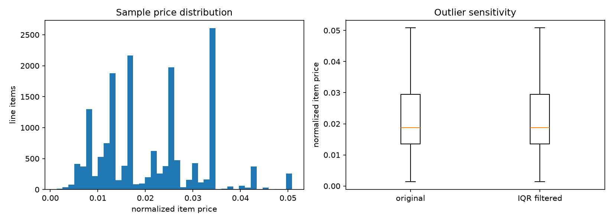
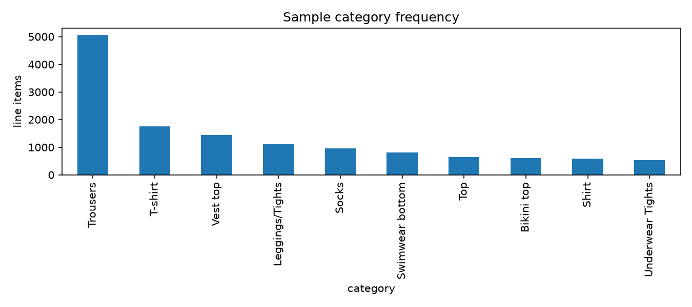
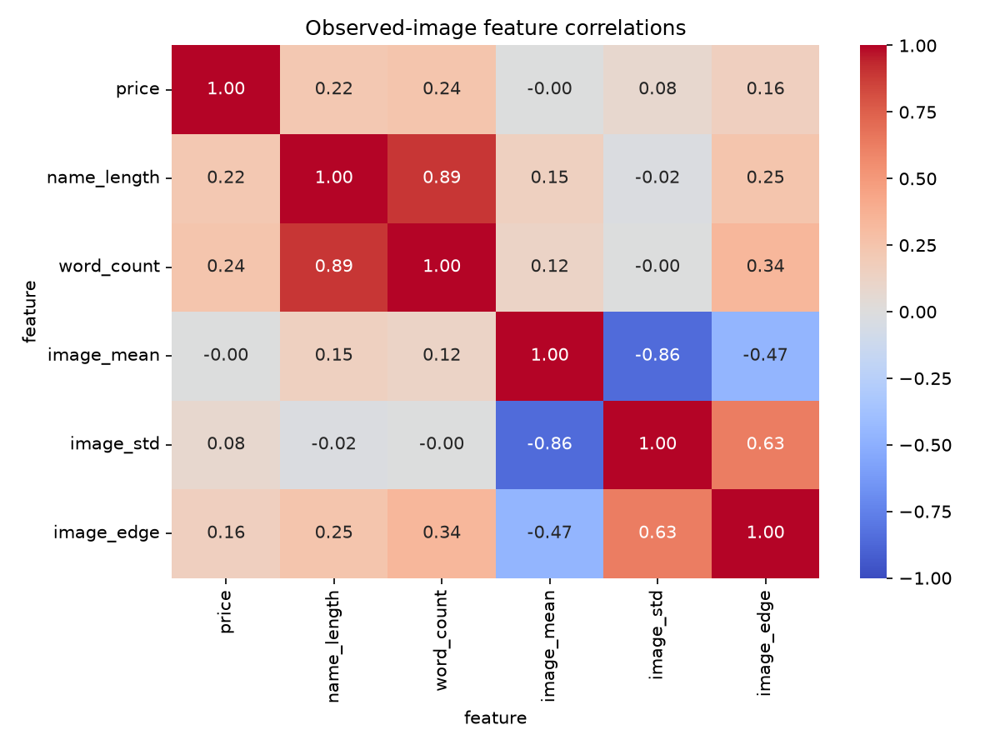
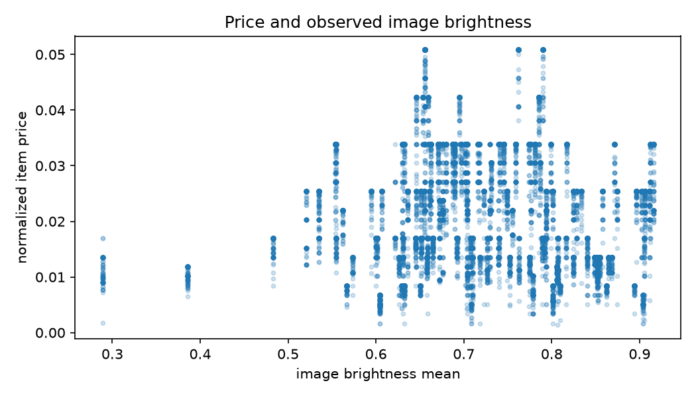
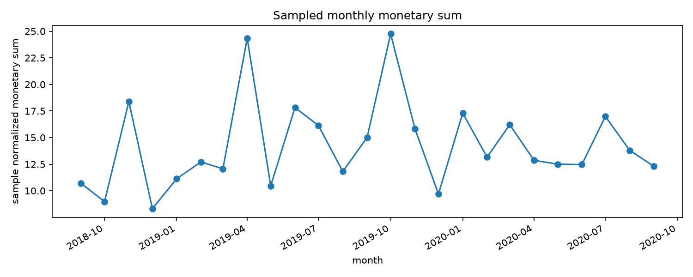
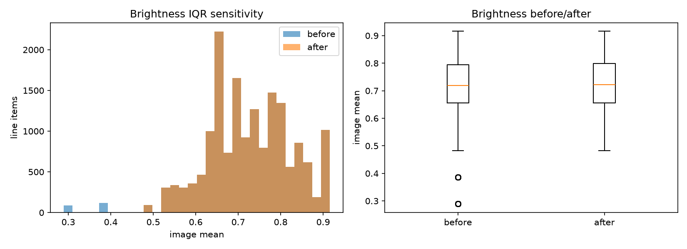
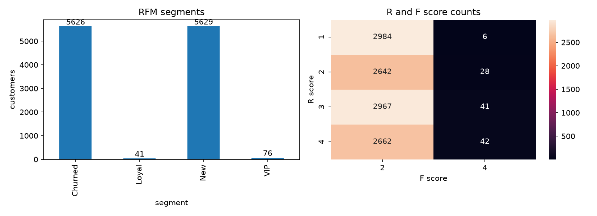
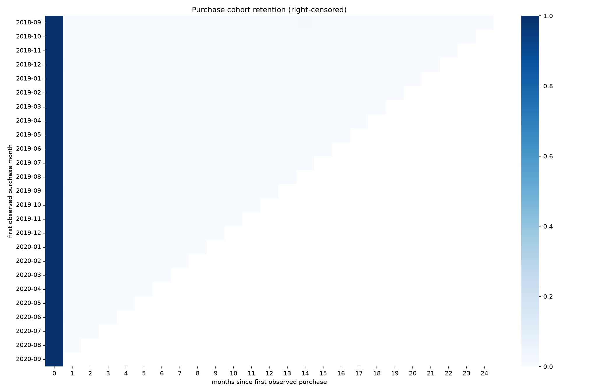

# 이커머스 멀티 모달 데이터 분석 및 RFM 비즈니스 인사이트 파이프라인 구축

상품 이미지/텍스트/가격과 실제 거래를 연결하고 EDA, RFM, 코호트, 인터랙티브 시각화를 수행합니다.

## 실행 환경

미션 전용 격리 환경에서 수행합니다. 실제 버전과 데이터 출처는 준비 후 기록합니다.

## 진행 상태

데이터 확보와 환경 준비 중입니다. 실제 실행 결과를 항목별로 추가합니다.

## 거래와 상품 데이터

H&M Personalized Fashion Recommendations 공개 미러의 커밋 `acde210b0090be673abdba5f989c48925c856f78`에서 상품 메타데이터와 실제 거래를 확보했습니다. 3.49GB 거래 전체 중 일정한 바이트 간격의 1MiB 구간 32개를 읽고 경계의 불완전한 레코드를 제거했습니다. 표본은 시간 구간을 분산한 것이며 고객 전체 거래 이력이라고 해석하지 않습니다.

```text
range 0 rows 9554
range 1 rows 9556
range 2 rows 9555
range 3 rows 9558
range 4 rows 9549
range 5 rows 9550
range 6 rows 9556
range 7 rows 9548
range 8 rows 9547
range 9 rows 9558
range 10 rows 9555
range 11 rows 9549
range 12 rows 9553
range 13 rows 9551
range 14 rows 9555
range 15 rows 9557
range 16 rows 9558
range 17 rows 9555
range 18 rows 9562
range 19 rows 9559
range 20 rows 9563
range 21 rows 9562
range 22 rows 9565
range 23 rows 9563
range 24 rows 9550
range 25 rows 9557
range 26 rows 9554
range 27 rows 9555
range 28 rows 9549
range 29 rows 9552
range 30 rows 9552
range 31 rows 9554
DONE 305761 transactions 36127865 article bytes
```

출처: [원 데이터 안내](https://data.hmgroup.com/), [공개 미러](https://huggingface.co/datasets/einrafh/hnm-fashion-recommendations-data). 이미지와의 연결 및 결측/분포 분석은 이어서 수행합니다. 원본 표본과 Range별 SHA-256은 실습 데이터에 보존합니다.

## 파이프라인 검증

이미지 평균/표준편차의 벡터 연산, 히스토그램 합, 그룹 대치/전체 통계 보완, IQR 원본 보존, 구매일 기준 Frequency, 코호트 우측 절단을 확인했습니다.

```text
$ python -m unittest discover -s tests -v
test_all_missing_rejected (test_pipeline.PipelineTests.test_all_missing_rejected)
모든 값이 결측이면 임의 숫자를 만들지 않는다. ... ok
test_bad_image_shapes (test_pipeline.PipelineTests.test_bad_image_shapes)
잘못된 차원과 비유한 값을 거절한다. ... ok
test_cohort_right_censoring (test_pipeline.PipelineTests.test_cohort_right_censoring)
관측되지 않은 미래 월을 재구매 0으로 채우지 않는다. ... ok
test_group_imputation_and_fallback (test_pipeline.PipelineTests.test_group_imputation_and_fallback)
그룹 통계와 전체 통계 보완의 실제 값을 확인한다. ... ok
test_iqr (test_pipeline.PipelineTests.test_iqr)
IQR 이상치와 원본 불변을 확인한다. ... ok
test_rfm_purchase_days (test_pipeline.PipelineTests.test_rfm_purchase_days)
Frequency를 같은 날 구매한 상품 수와 혼동하지 않는다. ... ok
test_vector_features (test_pipeline.PipelineTests.test_vector_features)
이미지별 독립 계산과 배치 벡터 연산을 비교한다. ... ok

----------------------------------------------------------------------
Ran 7 tests in 0.118s

OK
```

## EDA와 이미지 피처

원본 상품 ID에 일치하는 사진 126개를 확보했습니다. 이미지 CDN은 404여서 거래와 같은 고정 revision의 사진 미러를 사용했습니다. 사진이 없는 상품 2개의 해당 거래 행은 category 평균으로 피처를 대치하고, 상관계수는 관측 이미지가 있는 행만 사용했습니다. 실제 가격과 거래는 바꾸지 않았습니다.

```text
$ python -m src.analysis eda --data data/analysis_transactions.csv --images data/images
{
  "rows": 16739,
  "columns": 16,
  "products": 128,
  "customers": 11372,
  "first_date": "2018-09-20",
  "last_date": "2020-09-22",
  "images_observed": 126,
  "image_missing_rows": 480,
  "iqr_bounds": [
    -0.010330508474576275,
    0.05333050847457627
  ],
  "outlier_count": 0,
  "brightness_outlier_count": 206,
  "brightness_iqr_bounds": [
    0.44839218239379103,
    1.0011852787990196
  ],
  "statistics": {
    "price": {
      "count": 16739.0,
      "mean": 0.021255601199269746,
      "std": 0.010402439764952226,
      "min": 0.0013389830508474577,
      "25%": 0.013542372881355931,
      "50%": 0.01871186440677966,
      "75%": 0.029457627118644067,
      "max": 0.050830508474576264
    },
    "name_length": {
      "count": 16739.0,
      "mean": 17.4870063922576,
      "std": 6.131977050131017,
      "min": 5.0,
      "25%": 13.0,
      "50%": 16.0,
      "75%": 24.0,
      "max": 30.0
    },
    "word_count": {
      "count": 16739.0,
      "mean": 3.267100782603501,
      "std": 1.2141573464562256,
      "min": 1.0,
      "25%": 2.0,
      "50%": 3.0,
      "75%": 4.0,
      "max": 6.0
    },
    "image_mean": {
      "count": 16739.0,
      "mean": 0.7232713385928418,
      "std": 0.10417977541425866,
      "min": 0.289093137254902,
      "25%": 0.6556895935457517,
      "50%": 0.7186517054738563,
      "75%": 0.7938878676470589,
      "max": 0.915872651143791
    },
    "image_std": {
      "count": 16739.0,
      "mean": 0.27545144981320374,
      "std": 0.11401107352420921,
      "min": 0.015205474442991767,
      "25%": 0.2203384075086901,
      "50%": 0.317546220117022,
      "75%": 0.3607536410175765,
      "max": 0.4063810403499021
    },
    "image_edge": {
      "count": 16739.0,
      "mean": 0.04812637615436799,
      "std": 0.020169815079584423,
      "min": 0.005499551971326165,
      "25%": 0.04053341766814252,
      "50%": 0.04905057453088762,
      "75%": 0.05798215791693021,
      "max": 0.12763085072738772
    }
  },
  "correlations": {
    "price_word_count": 0.24276810240735539,
    "price_image_mean": -0.004372270195836988
  },
  "monthly_sample_monetary": {
    "2018-09-01": 10.69364406779661,
    "2018-10-01": 8.98406779661017,
    "2018-11-01": 18.39415254237288,
    "2018-12-01": 8.322423728813558,
    "2019-01-01": 11.128474576271184,
    "2019-02-01": 12.711322033898304,
    "2019-03-01": 12.067254237288134,
    "2019-04-01": 24.34850847457627,
    "2019-05-01": 10.453999999999999,
    "2019-06-01": 17.833322033898305,
    "2019-07-01": 16.12406779661017,
    "2019-08-01": 11.814406779661017,
    "2019-09-01": 15.01908474576271,
    "2019-10-01": 24.753406779661013,
    "2019-11-01": 15.846152542372883,
    "2019-12-01": 9.700203389830508,
    "2020-01-01": 17.307271186440673,
    "2020-02-01": 13.16050847457627,
    "2020-03-01": 16.21377966101695,
    "2020-04-01": 12.859762711864406,
    "2020-05-01": 12.506016949152542,
    "2020-06-01": 12.463576271186438,
    "2020-07-01": 16.993135593220337,
    "2020-08-01": 13.805338983050847,
    "2020-09-01": 12.293627118644068
  },
  "missing_before": {
    "order_date": 0,
    "customer_id": 0,
    "article_id": 0,
    "price": 0,
    "sales_channel_id": 0,
    "product_name": 0,
    "category": 0,
    "colour": 0,
    "department": 0,
    "detail_desc": 0,
    "name_length": 0,
    "word_count": 0,
    "image_mean": 480,
    "image_std": 480,
    "image_edge": 480,
    "image_available": 0
  },
  "imputation": {
    "before": {
      "image_mean": 480,
      "image_std": 480,
      "image_edge": 480
    },
    "after": {
      "image_mean": 0,
      "image_std": 0,
      "image_edge": 0
    }
  }
}
```











분석 표본은 16,739행/128상품/11,372고객입니다. 가격은 원 데이터의 정규화 단위이며 원화/달러 매출로 해석하지 않습니다. IQR 밖 0행은 분포 비교용으로만 분리했고 실제 구매를 오류로 단정해 RFM에서 삭제하지 않았습니다.

가격과 단어 수 상관계수는 0.2428, 관측 이미지 밝기와는 -0.0044입니다. 이 상관관계만으로 상품 설명이나 촬영 밝기가 가격을 결정한다고 해석할 수 없으며, 카테고리/상품 선택의 영향을 함께 고려해야 합니다.

가격의 기본 IQR 경계에서는 이상치가 0건이었습니다. 별도로 이미지 밝기에서 실제 206행을 탐지하고 전후 분포를 비교했습니다. 이상치 판정만으로 데이터 오류라고 단정하지 않습니다.



## RFM 고객 세분화

기준일은 최종 관측일 다음 날입니다. 주문 ID가 없어 Frequency는 서로 다른 관측 구매일 수로 정의하고 Monetary는 실제 상품 행 금액 합계로 계산했습니다. 동일 날 여러 상품을 구매한 행을 여러 주문으로 세지 않았습니다.

```text
$ python -m src.analysis rfm --interactive
{
  "reference_date": "2020-09-23",
  "customer_count": 11372,
  "frequency_definition": "distinct observed purchase dates, not line-item count",
  "segments": {
    "Churned": {
      "customers": 5626,
      "mean_recency": 549.1551724137931,
      "mean_frequency": 1.0,
      "mean_monetary": 0.030856845035458855,
      "total_monetary": 173.60061016949152
    },
    "Loyal": {
      "customers": 41,
      "mean_recency": 427.8048780487805,
      "mean_frequency": 2.0,
      "mean_monetary": 0.05857999173212071,
      "total_monetary": 2.401779661016949
    },
    "New": {
      "customers": 5629,
      "mean_recency": 179.9236098774205,
      "mean_frequency": 1.0,
      "mean_monetary": 0.031083986980256596,
      "total_monetary": 174.9717627118644
    },
    "VIP": {
      "customers": 76,
      "mean_recency": 186.03947368421052,
      "mean_frequency": 2.013157894736842,
      "mean_monetary": 0.06346520963425513,
      "total_monetary": 4.823355932203389
    }
  }
}
```



[인터랙티브 RFM 차트](outputs/rfm-interactive.html)는 Plotly 보너스 구현입니다.

## 코호트 재구매 분석

계정 생성일이 제공되지 않아 코호트 가입월은 표본에서 최초로 관측한 구매월로 정의했습니다. 실제 계정 가입월/생애 최초 구매월과는 구분합니다. 아직 관측할 수 없는 미래 기간은 0이 아닌 결측으로 남겼습니다.

```text
$ python -m src.analysis cohort
{
  "cohorts": 25,
  "periods": 25,
  "first_purchase_definition": "first observed purchase in sampled time ranges; account signup dates unavailable",
  "right_censored_cells": 300,
  "period_zero_min": 1.0,
  "period_zero_max": 1.0
}
```



## 데이터 준비 재현

고정 revision, Range 응답 검증과 SHA-256을 포함한 `src.dataset`으로 같은 표본을 준비할 수 있습니다. 캐시를 이용한 전체 재현에서 선택 CSV가 원본 표본과 바이트 단위로 일치했습니다. 사진 2개의 404는 성공으로 처리하지 않고 결측 상태로 남깁니다. 원본 데이터와 사진은 저장소에 재배포하지 않습니다.

```text
$ python -m src.dataset --output data
{
  "revision": "acde210b0090be673abdba5f989c48925c856f78",
  "raw_rows": 305761,
  "selected_rows": 16739,
  "products": 128,
  "images_downloaded": 126,
  "images_failed": 2,
  "articles_sha256": "25f21882053517f7684ea43f524225a9481a7bb9aab9cf0abfc7fe8c4576a72b",
  "selected_csv_sha256": "183c0bc8dbb1df689f3cb145dc85fd4410d26e617da918753b823a654161c1ea"
}
```

재구매가 없는 관측 가능한 달도 표에서 빠지지 않도록 전체 월을 명시적으로 재색인했습니다. 관측 가능한 0과 미래 미관측을 구분하는 회귀 검사를 추가했습니다.
